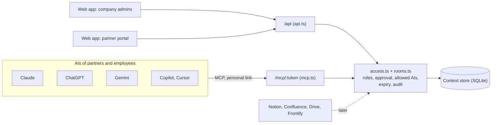

# Architecture

## Approach

The product is not a chatbot but a layer between the AIs people already use and the company's knowledge. The value sits in the rules (roles, approval, allowed AIs, expiry, audit), not in the UI. So the MVP starts from the data model and one module of rules, and both the web app and the MCP connector sit on top of it. The UI follows the sketches in the product doc.

## Data model

| Table | Meaning |
|---|---|
| `companies`, `people` | Customer and partner companies; each person has a secret token for their MCP link |
| `rooms` | One project, owned by one company, with expiry date and allowed AIs |
| `layers` | Audience slices of a room, e.g. "Everyone in the room", "Catering", "Project leads only" |
| `roles` | Which layers a member sees, e.g. Catering = Everyone + Catering |
| `memberships` | Person in room with role, declared AI, access until, revoked at |
| `entries` | Knowledge with layer, author and status `approved`, `pending` or `rejected` |
| `audit_log` | Every read, search, suggestion, approval, invitation and revocation |

## Rules (server/access.ts)

* **Reading:** only approved entries in the layers of the member's role. Access requires: not revoked, membership not expired, room not expired, AI allowed in the room.
* **Writing:** the owner company's people save directly. Partners create a suggestion; an admin of the owner company approves it (optionally into another layer) or rejects it. If no layer is given, the most restricted layer the person can see is used, so nothing is shared wider than intended.
* **Allowed AIs:** detected from the MCP client name sent on connect (e.g. `claude-code`, `cursor-vscode`), falling back to the AI set on the membership. This name is self reported by the client, so it is a policy check, not a security boundary.
* **Revocation:** stops all future access. What an AI has already read cannot be taken back; the audit log shows what that was.
* **Audit:** every MCP read logs AI, person and layers or query. Portal previews are logged too.

## Decisions for the MVP

| Decision | Why | Later |
|---|---|---|
| One TypeScript codebase (Express, React, Vite) | Fast to change for a small team | Split when needed |
| SQLite via `node:sqlite` | No setup, no native build | Postgres plus an existing vector database |
| Keyword search | Rooms are small; enough to demo | Embeddings / vector search |
| Personal secret link per person for MCP | Works with every MCP client today | OAuth 2.1 as per the MCP spec |
| Demo person switcher instead of login | Focus on the core flow | Magic link or SSO (Microsoft, Google) |
| In memory MCP sessions | Single server | Shared session store or stateless mode |

## Next steps

1. Validate with the 10 to 15 SME interviews: is the control problem strong enough to pay for?
2. Real login and OAuth for the MCP connector.
3. First source connection (Notion or Google Drive), read through without copying.
4. Vector search and hosting in Switzerland or the EU.
5. Browser extension for AIs without MCP support in their web chat.
